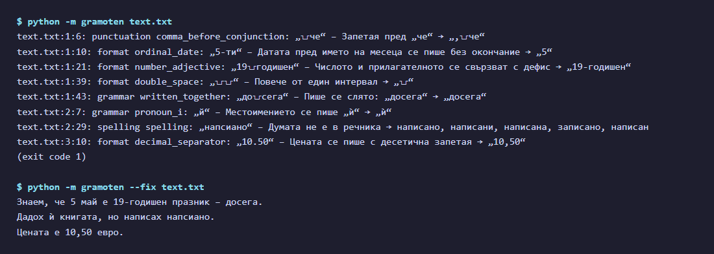
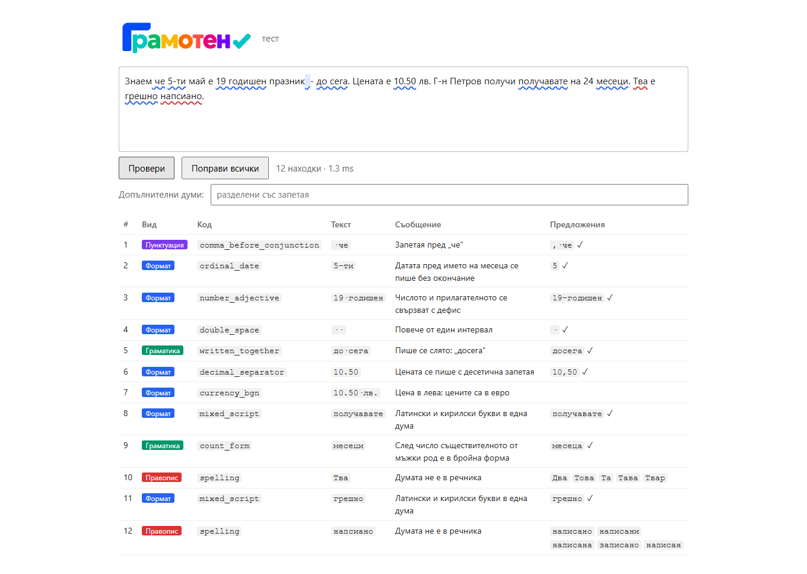
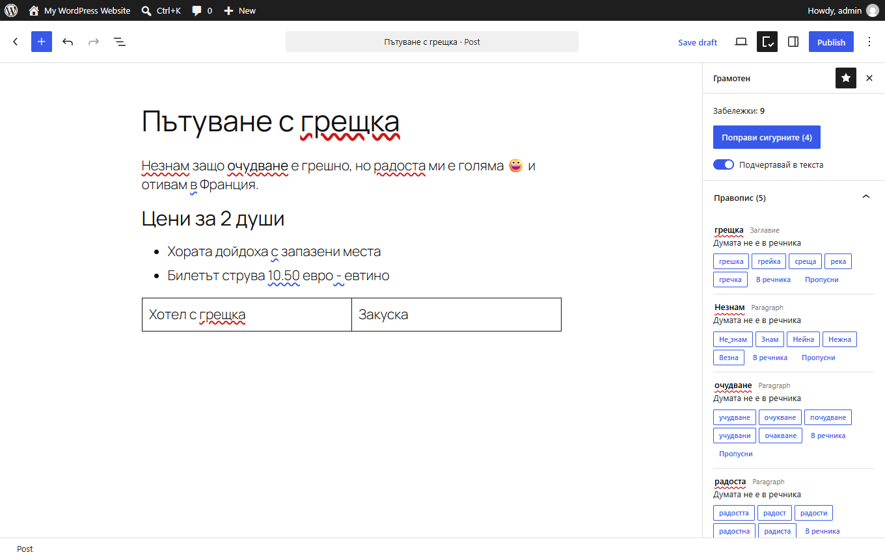

<p align="center"></p>

<p align="center"><a href="https://github.com/vjfrosty/gramoten/blob/main/README.md">Български</a> · <b>English</b></p>

<p align="center">
  <a href="https://github.com/vjfrosty/gramoten/actions/workflows/ci.yml"></a>
  
  
  
</p>

# gramoten: Bulgarian spell checker and grammar checker for Python

**gramoten** (Грамотен, "literate") is an offline **Bulgarian spell checker**, **grammar checker** and **punctuation checker** for Python. It checks any Bulgarian (Cyrillic) text by rule, with no language model, no API and no network. It finds spelling mistakes, missing commas, grammar errors and typography problems, and proposes fixes; it never changes the text by itself. Use it as a Python library, from the command line, as a small HTTP service behind a web editor, or as a WordPress plugin.

| | |
|---|---|
| **Checks** | spelling, punctuation (commas), grammar, orthography, typography and format, mixed Latin/Cyrillic, fonts in e-mail HTML |
| **Language** | Bulgarian (български език) |
| **Works as** | Python library · command line tool · HTTP endpoint for a web page · [WordPress plugin](#wordpress-plugin) |
| **Needs** | Python 3.11+ and one library, `marisa-trie` (wheels for Windows, macOS, Linux) |
| **Speed** | about 12 ms for a 300-word e-mail; word lists load once in about 15 ms |
| **Memory and size** | about 45 MB of RAM; the wheel is about 11 MB with every word list |
| **Privacy** | runs in your process, offline; text never leaves the machine |
| **Licence** | MIT code; MPL-1.1 and CC BY data (see [Licence](#licence)) |

## Contents

- [Quick start](#quick-start)
- [See it working](#see-it-working)
- [What it checks, with examples](#what-it-checks-with-examples)
- [Why gramoten](#why-gramoten)
- [Install](#install)
- [Use it in an app](#use-it-in-an-app)
- [Command line](#command-line)
- [WordPress plugin](#wordpress-plugin)
- [Word lists and accuracy](#word-lists-and-accuracy)
  - [Sound-alike search](#sound-alike-search-words-written-as-they-are-heard)
- [FAQ](#faq)
- [Project layout](#project-layout)
- [Build and test](#build-and-test)
- [Licence](#licence)

## Quick start

```bash
pip install git+https://github.com/vjfrosty/gramoten
```

```python
import gramoten

for issue in gramoten.check("Знаем че 5-ти май е 19 годишен празник  - до сега."):
    print(issue.kind, issue.code, repr(issue.text), "->", issue.fix, issue.message_bg)

gramoten.fix_text("Знаем че до сега.")   # 'Знаем, че досега.': every certain fix, never spelling
```

`check()` returns a list of findings (`Issue`), each with exact offsets, the rule, a message in English and Bulgarian and, where the correction is certain, the fix. `fix_text()` applies every certain fix; spelling is never changed automatically.

## See it working

**Command line.** `python -m gramoten text.txt` lists the findings by line and column, and `--fix` returns the corrected text. Spelling stays with a person: `напсиано` is flagged but not changed.



**Test page.** `python -m gramoten serve` opens a page on http://localhost:8765 that shows every finding with its kind, rule, message and suggestions.



**WordPress.** The plugin underlines mistakes in the editor, and its sidebar explains them and offers suggestions.



## What it checks, with examples

All examples below are real output of `gramoten.check()` and `gramoten.fix_text()`.

### Spelling

Flags unknown words and suggests up to five: known corrections first, then the closest by letters and by sound, common words before rare ones. Never auto-fixes.

| Written | First suggestions |
|---|---|
| `напсиано` | `написано`, `написани`, `написана` |
| `подтиска` (written as it sounds) | `потиска` |
| `фучбол` (written as it sounds) | `футбол` |

### Punctuation

Commas before conjunctions and relative words, after a vocative, inside compounds such as `въпреки, че`; doubled marks, unbalanced brackets and quotes.

| Wrong | Right |
|---|---|
| `Знаем че идваш.` | `Знаем, че идваш.` |
| `Въпреки, че вали, излязохме.` | `Въпреки че вали, излязохме.` |

### Grammar

Double article, article after a preposition or a copula, count forms (`24 месеци`), `в/във`, `с/със`, agreement with `Вие`, repeated words.

| Wrong | Right |
|---|---|
| `Чакахме 24 месеци.` | `Чакахме 24 месеца.` |
| `в връзка с това` | `във връзка с това` |
| `с сестра си` | `със сестра си` |
| `това това е` | `това е` |

### Orthography

`й` → `ѝ`, ordinals (`5-ти` → `5-и`), dates, `19-годишен`, `10-процентна`, `г-н` without a full stop, words written together (`досега`).

| Wrong | Right |
|---|---|
| `Дадох й книгата.` | `Дадох ѝ книгата.` |
| `На 5-ти май.` | `На 5 май.` |
| `19 годишен`, `10 процентна` | `19-годишен`, `10-процентна` |
| `Г-н. Петров` | `Г-н Петров` |
| `До сега не знаех.` | `Досега не знаех.` |

### Format and typography

Dashes, Bulgarian quotation marks, spaces, ellipsis, decimal comma, the euro sign; prices in leva are flagged, with no conversion.

| Wrong | Right |
|---|---|
| `Вижте "Плати онлайн".` | `Вижте „Плати онлайн“.` |
| `Ела  тук - сега...` | `Ела тук – сега…` |
| `10.50 лв.` | `10,50 лв.` (and the price in leva is flagged) |

### Mixed script

Latin letters inside a Cyrillic word and the reverse.

| Wrong | Right |
|---|---|
| `пoлучавате` (Latin `o`) | `получавате` |
| `ВMW` (Cyrillic `В`) | `BMW` |

### Fonts in e-mail HTML

Fonts that never load, Office leaks, missing fallbacks, name variants, `<font>` tags, fonts outside the template's own (`from gramoten import fonts`).

It is not a style editor and does not rewrite sentences. It finds what can be decided by rule and leaves the rest alone.

## Why gramoten

gramoten is meant to be a quick, free Bulgarian spell checker that any app can build in. In practice that means:

- **Quick.** A 300-word e-mail is checked in about 12 ms, and the word lists load once in about 15 ms. That is fast enough to check text as the user types, or to check every message a server sends.
- **Free of cost.** The code is MIT and the word lists come from open sources (see [Licence](#licence)). There is no API key, no per-word fee, no account and no usage limit.
- **Offline and private.** Everything runs in the same process, with no network calls and no language model. The text never leaves the machine, and results are the same on every run and every machine.
- **Small.** The only dependency is `marisa-trie`. The wheel is about 11 MB with every word list, and a process with everything loaded takes about 45 MB of RAM.
- **Catches words written as they sound.** Many Bulgarian misspellings come from writing a word the way it is pronounced (`подтискам` for `потискам`, `до сега` for `досега`). The 386,241 known misspellings and gramoten's own corrections catch these and suggest the right form first. For any other unknown word, a phonetic search tries the changes that sound the same in Bulgarian (`а/ъ`, `о/у`, `е/и`, `д/т`, `з/с`, `я` as `йа`, a lost `т` in `чесно`) and ranks those words above other near words: `фучбол` → `футбол`, `здрафейти` → `здравейте`. On misspellings written by sound, the first suggestion is right 95% of the time, against 52% with letter edits alone.
- **Safe.** It reports problems and proposes fixes. The app or the user decides what to apply, and spelling is never changed automatically.

## Install

Python 3.11 or newer. The only dependency is `marisa-trie`, which has wheels for Windows, macOS and Linux.

```bash
pip install gramoten-0.1.0-py3-none-any.whl           # a built wheel (uv build, or the CI artifact)
pip install git+https://github.com/vjfrosty/gramoten   # straight from the repository
pip install -e .                                      # from a checkout, for development
```

Once it is on PyPI: `pip install gramoten` (or `uv add gramoten`). The wheel holds the word lists (about 11 MB); nothing is downloaded at run time.

## Use it in an app

The short version: call `gramoten.check(text)` and show the findings; apply the ones the user accepts with `gramoten.apply_fixes`. A web endpoint takes a few lines:

```python
from fastapi import FastAPI  # any web framework works the same way
import gramoten

app = FastAPI()


@app.post("/check")
def check(body: dict) -> dict:
    words = frozenset(w.lower() for w in body.get("extra", []))
    return {"issues": [i.to_json() for i in gramoten.check(body["text"], words)]}
```

The full guide, with the JSON shape, offsets in JavaScript, your own words, threads and speed, is "Integrating" in [`src/gramoten/README.md`](src/gramoten/README.md#integrating).

## Command line

```bash
python -m gramoten text.txt          # findings with line and column; exit 1 when something is found
python -m gramoten --fix text.txt    # the corrected text
python -m gramoten serve             # a test page on http://localhost:8765
```

The exit codes make it usable in scripts, pre-commit hooks and CI. The full reference (every rule, its fix, how it was measured) is [`src/gramoten/README.md`](src/gramoten/README.md), in the source and in the installed package (`gramoten/README.md`).

## WordPress plugin

The [`wordpress/`](wordpress/) folder holds a plugin for the block editor. The checker is ported to TypeScript and runs in the writer's browser: no server, no external service, and the text never leaves the browser. A test in CI compares its findings and fixes with the Python package's.

- **What it checks:** the title and the text in blocks, including tables, quotes, columns and image captions, and the text in Custom HTML, Classic and Shortcode blocks (not their tags and attributes). Code blocks are not checked.
- **What it does:** underlines mistakes, offers fixes, applies all certain fixes at once (with undo), and keeps a personal dictionary in each user's profile.
- **Needs:** WordPress 6.6 or later, PHP 7.4 or later and a recent browser. It works in the block editor only.

The plugin is not in the WordPress.org directory yet. [`wordpress/README.md`](wordpress/README.md) describes how to build and install it. The zip is about 9.3 MB because the word lists are inside it; if a host refuses a file that size, [`readme.txt`](wordpress/plugin/readme.txt) lists ways to install it without an upload.

**Known limits:**

- Custom HTML, Classic and Shortcode blocks show their findings in the sidebar only, without underlines.
- Since WordPress 7.1, changing a Custom HTML block from outside it breaks undo, with or without the plugin. So there the finding is listed and the correction is made in the block itself.
- „Поправи сигурните“ sometimes needs a second press: the first can lead to a new minor fix, such as a non-breaking space in `10,50 евро`.

## Word lists and accuracy

**Word lists:**
- the bgOffice dictionary, 866,654 forms (MPL-1.1), and a morphology built from it;
- 46,888 modern words from news, Wikipedia and 675M words of web text, about 2,900 more read word by word, and 49,978 of their other forms made with the dictionary's paradigms;
- telecom terms, 1,171 forms of address, EU legal words, and 7,870 names (with every Bulgarian settlement, from the EKATTE register);
- 386,241 searched misspellings with their corrections;
- gramoten's own corrections for misspellings the other lists miss.

**Measured (2026-11-03):** spelling flags per 1,000 words on text the word lists never saw. A flag is not always a false alarm: real typos are counted too.

| Text | Flags per 1,000 words |
|---|---|
| Web text (MaCoCu-bg, 7,757 held-out paragraphs, 325,321 words) | 7.17 |
| News (Leipzig 2022, 10,000 sentences, 173,644 words) | 5.91 |
| bg.wikipedia (34 random articles, 17,535 words) | 13.97 |

What is flagged is mostly rare words, dialect and slang (`абе`, `нема`), old spelling (`казватъ`), abbreviations with no full stop (`изм`, `авг`) and names at a sentence start. A name an app's texts use goes in that app's own word list (`--words FILE`), not in the package.

Speed is about 0.17 M characters a second on news text, so a 300-word e-mail takes about 12 ms. A process with the package and every list loaded takes about 45 MB of RAM; loading the lists takes about 15 ms, once.

### Sound-alike search: words written as they are heard

Many Bulgarian misspellings are a word written the way it is pronounced. Letter edits alone rank such words poorly: `фучбол` is one edit from `футбол`, but also from several other words. So for every unknown word, gramoten also looks for the known words it becomes by changes that sound the same, or nearly so, in Bulgarian:

| Change | Example |
|---|---|
| Reduced unstressed vowels: `а/ъ`, `о/у`, `е/и`, and `я/е`, `я/ъ`, `я/а`, `ю/у` | `градинъта` → `градината`, `телефуна` → `телефона` |
| Voiced and voiceless consonants: `б/п`, `в/ф`, `г/к`, `д/т`, `ж/ш`, `з/с` | `фучбол` → `футбол`, `здрафейти` → `здравейте` |
| Letters spelt out by sound: `я` as `йа`/`йъ`, `ю` as `йу`, `щ` as `шт`, `ьо`/`йо`, `ия` heard as `еъ`/`иъ`/`ийъ`/`еа` | `разсейан` → `разсеян` |
| A `т` or `д` lost between consonants: `стн`/`сн`, `здн`/`зн`, `ст`/`с` | `обласна` → `областна` |
| A doubled or undoubled letter | `оттдел` → `отдел` |

Each sound-alike change costs half an ordinary edit (`SOUND_COST = 0.5`), and words are ranked by cost minus 0.3 × log10 of how often the word is used (`FREQUENCY_WEIGHT = 0.3`). So a word written by sound reaches its right form before words that are merely close in letters, and a common word can come before a slightly closer rare one. A known misspelling's correction always comes first.

**Measured** on 3,000 misspellings from Chitanka's table with their listed corrections hidden (half of them not used to set the weights), and on random typos of common words:

| Test | Letter edits only | With sound-alike search |
|---|---|---|
| Words written by sound: right word first | 52% | **95%** |
| Words written by sound: right word in the top 5 | 68% | **99%** |
| Random one-edit typos: right word first | 89% | 87% |
| Random two-edit typos: first / top 5 | 65% / 88% | 65% / 88% (unchanged) |

**Cost:** whole texts check 2–5% slower (0.185 → 0.181 M characters a second on news), and one suggestion takes 21.7 ms on average instead of 21.5 ms. The search walks the word lists letter by letter, so it finds the same words on every run.

The code is `_sound_alikes`, `SOUND_ALIKE`, `SOUND_COST` and `FREQUENCY_WEIGHT` in [`src/gramoten/spelling.py`](src/gramoten/spelling.py). A test in `tests/test_spelling.py` checks six words written by sound that are in no misspelling list (`фучбол`, `градинъта`, `здрафейти`, `телефуна`, `юнушескъ`, `млекуту`), and expects the right word first for each one. The full description is in "Spelling: how it works and what it costs" in [`src/gramoten/README.md`](src/gramoten/README.md#spelling-how-it-works-and-what-it-costs).

## FAQ

**How do I check Bulgarian spelling in Python?**
Install gramoten and call `gramoten.check(text)`. It returns every finding with its position, a message and suggestions. See [Quick start](#quick-start).

**Does it work offline? Does it send text anywhere?**
Yes, it works fully offline. It makes no network calls and uses no language model or external API, so the text stays on your machine.

**Does it fix the text automatically?**
Only when you ask: `fix_text()` and `apply_fixes()` apply the certain fixes (commas, dashes, quotation marks, `ѝ` and so on). Spelling is never changed automatically; the user picks a suggestion.

**Can I use it from JavaScript, a browser editor or another language?**
Yes, over HTTP. Run a small endpoint (see [Use it in an app](#use-it-in-an-app)) or `python -m gramoten serve`, and send the text as JSON. The integration guide shows how to convert offsets for JavaScript strings.

**How do I stop it flagging my product names and brands?**
Pass your own words as `extra` in Python, or `--words FILE` / `--extra WORDS` on the command line.

**Is there a WordPress plugin?**
Yes, for the block editor, in the [`wordpress/`](wordpress/) folder. It runs entirely in the browser. See [WordPress plugin](#wordpress-plugin).

**Can I use it in a commercial product?**
Yes. The code is MIT. The word lists carry MPL-1.1 and CC BY terms: both allow commercial use, CC BY asks for attribution, and MPL-1.1 asks that changes to those data files stay open. See [Licence](#licence) and `NOTICE`.

**Is it a style editor or an AI writing assistant?**
No. It does not rewrite sentences. It finds what can be decided by rule, so the same text always gets the same result.

## Project layout

| Folder | Holds |
|---|---|
| `src/gramoten/` | The package: code, its word lists (`data/`, 17 MB) and the full reference README. |
| `tests/` | The tests, one file per area: spelling, format, punctuation, grammar, fonts and the API. |
| `tools/` | The scripts that rebuild the word lists from their sources, and the sources' licences (`tools/bg_BG/SOURCE.md`). |
| `assets/` | The logo, icons and screenshots. |
| `wordpress/` | The WordPress plugin: the checker in TypeScript, the editor side, the browser tests. |

## Build and test

```bash
uv run --group dev pytest -q          # tests
uv run --group dev ruff check src tests tools
uv run --group dev mypy               # types
uv build                              # wheel and sdist in dist/
```

CI (`.github/workflows/ci.yml`) runs the same on Linux, macOS and Windows, Python 3.11 to 3.13, and tests the WordPress plugin separately: a comparison with the Python package, and browser tests in real WordPress with Chrome, Firefox, WebKit and Safari. Changes are listed in `CHANGELOG.md`.

It depends on `marisa-trie` only and needs Python 3.11 or newer.

## Licence

| Part | Licence |
|---|---|
| Code and gramoten's own lists | MIT, © 2026 Yasen Ivanov (`LICENSE`) |
| Spelling dictionary, morphology and lists built with them | MPL-1.1, from bgOffice's GPL/LGPL/MPL dictionary |
| Misspelling table | MIT, from Chitanka |
| Word counts behind modern words, names and ranking | CC BY, Leipzig Corpora Collection |
| EU legal words | © European Union, Decision 2011/833/EU |
| The WordPress plugin as a whole (`wordpress/`) | GPL-3.0-or-later; the bgOffice dictionary is used there under GPL-2.0-or-later (`wordpress/plugin/NOTICE`) |

Credits: `NOTICE`; sources: `tools/bg_BG/SOURCE.md`, `tools/morphology/SOURCE.md`. `pyproject.toml` declares `MIT AND MPL-1.1 AND LicenseRef-Leipzig-CC-BY`.
