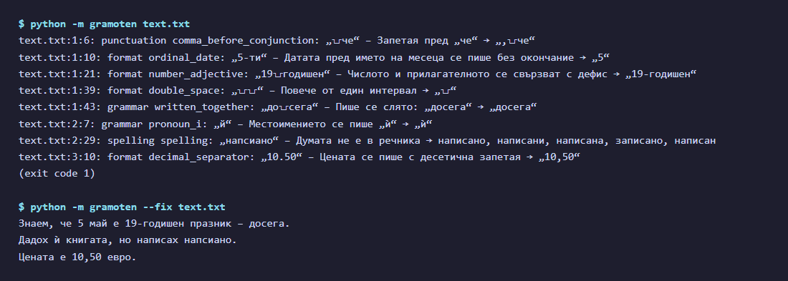
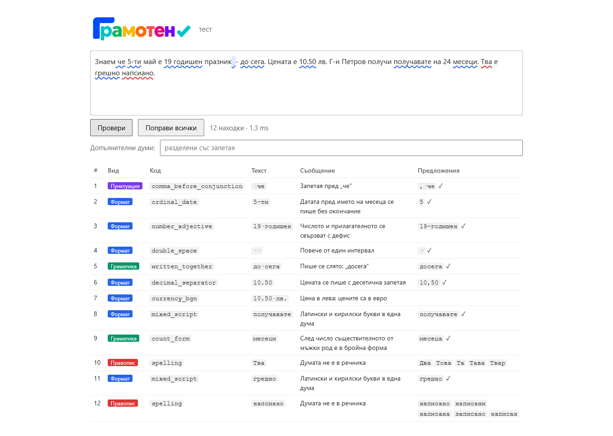
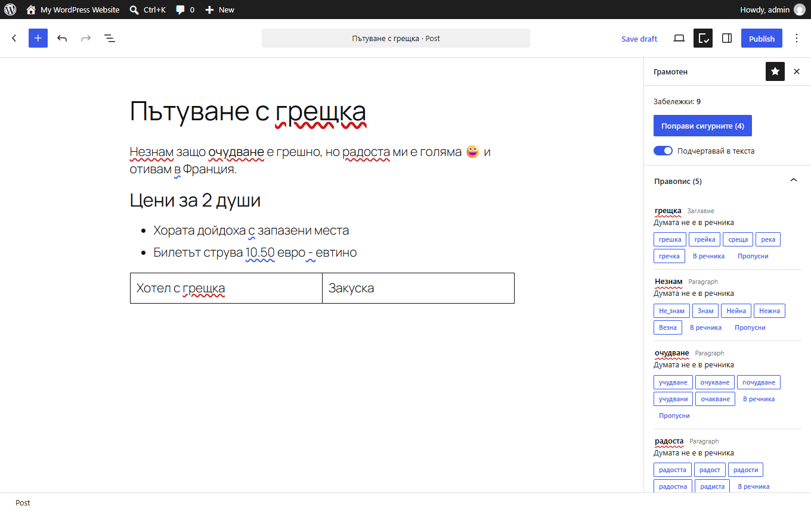

<p align="center"></p>

<p align="center"><b>Български</b> · <a href="https://github.com/vjfrosty/gramoten/blob/main/README.en.md">English</a></p>

<p align="center">
  <a href="https://github.com/vjfrosty/gramoten/actions/workflows/ci.yml"></a>
  
  
  
</p>

# Грамотен: проверка на правописа, пунктуацията и граматиката на български език

**Грамотен** (`gramoten`) е **български коректор** — библиотека на Python за **проверка на правописа**, **пунктуацията** и **граматиката** на всеки текст на български език. Работи по правила, без езиков модел, без API и без интернет. Открива правописни грешки, пропуснати запетаи, граматически грешки и проблеми с оформлението и предлага поправки, но никога не променя текста сам. Може да се използва като библиотека в Python, от командния ред, като малка HTTP услуга зад уеб редактор или като плъгин за WordPress.

| | |
|---|---|
| **Проверява** | правопис, пунктуация (запетаи), граматика, правописни правила, типография и оформление, смесена латиница и кирилица, шрифтове в HTML имейли |
| **Език** | български |
| **Използва се като** | библиотека на Python · инструмент за команден ред · HTTP услуга за уеб страница · [плъгин за WordPress](#плъгин-за-wordpress) |
| **Изисква** | Python 3.11+ и една библиотека, `marisa-trie` (има готови пакети за Windows, macOS и Linux) |
| **Скорост** | около 12 ms за имейл от 300 думи; речниците се зареждат еднократно за около 15 ms |
| **Памет и размер** | около 45 MB RAM; пакетът е около 11 MB с всички речници |
| **Поверителност** | работи в процеса на приложението, офлайн; текстът не напуска машината |
| **Лиценз** | кодът е под MIT, данните — под MPL-1.1 и CC BY (вж. [Лиценз](#лиценз)) |

## Съдържание

- [Бърз старт](#бърз-старт)
- [Как изглежда](#как-изглежда)
- [Какво проверява — с примери](#какво-проверява--с-примери)
- [Защо Грамотен](#защо-грамотен)
- [Инсталиране](#инсталиране)
- [Вграждане в приложение](#вграждане-в-приложение)
- [Команден ред](#команден-ред)
- [Плъгин за WordPress](#плъгин-за-wordpress)
- [Речници и точност](#речници-и-точност)
  - [Търсене по звучене](#търсене-по-звучене-думи-написани-както-се-чуват)
- [Често задавани въпроси](#често-задавани-въпроси)
- [Структура на проекта](#структура-на-проекта)
- [Компилиране и тестове](#компилиране-и-тестове)
- [Лиценз](#лиценз)

## Бърз старт

```bash
pip install git+https://github.com/vjfrosty/gramoten
```

```python
import gramoten

for issue in gramoten.check("Знаем че 5-ти май е 19 годишен празник  - до сега."):
    print(issue.kind, issue.code, repr(issue.text), "->", issue.fix, issue.message_bg)

gramoten.fix_text("Знаем че до сега.")   # 'Знаем, че досега.': всички сигурни поправки, без правописните
```

`check()` връща списък с находки (`Issue`). Всяка има точна позиция в текста, правилото, съобщение на български и английски и — когато поправката е сигурна — самата поправка. `fix_text()` прилага всички сигурни поправки; правописът никога не се поправя автоматично.

## Как изглежда

**Команден ред.** `python -m gramoten text.txt` показва находките с ред и колона, а `--fix` връща поправения текст. Правописът остава за човека: `напсиано` е отбелязано, но не е променено.



**Тестова страница.** `python -m gramoten serve` отваря страница на http://localhost:8765, в която се вижда всяка находка с вида, правилото, съобщението и предложенията.



**WordPress.** Плъгинът подчертава грешките в редактора, а в страничния панел има обяснение и предложения.



## Какво проверява — с примери

Всички примери по-долу са истински резултати от `gramoten.check()` и `gramoten.fix_text()`.

### Правопис

Отбелязва непознатите думи и предлага до пет правилни: първо известните поправки, после най-близките по букви и по звучене, като честите думи са преди редките. Никога не поправя автоматично.

| Написано | Първи предложения |
|---|---|
| `напсиано` | `написано`, `написани`, `написана` |
| `подтиска` (написано както се чува) | `потиска` |
| `фучбол` (написано както се чува) | `футбол` |

### Пунктуация

Запетаи пред съюзи и относителни думи, след обръщение и в съставни съюзи като `въпреки, че`; удвоени знаци, незатворени скоби и кавички.

| Грешно | Правилно |
|---|---|
| `Знаем че идваш.` | `Знаем, че идваш.` |
| `Въпреки, че вали, излязохме.` | `Въпреки че вали, излязохме.` |

### Граматика

Двоен член, член след предлог или след свързка, бройна форма (`24 месеци`), `в/във`, `с/със`, съгласуване с учтивото `Вие`, повторени думи.

| Грешно | Правилно |
|---|---|
| `Чакахме 24 месеци.` | `Чакахме 24 месеца.` |
| `в връзка с това` | `във връзка с това` |
| `с сестра си` | `със сестра си` |
| `това това е` | `това е` |

### Правописни правила

`й` → `ѝ`, редни числителни (`5-ти` → `5-и`), дати, `19-годишен`, `10-процентна`, `г-н` без точка, слято писане (`досега`).

| Грешно | Правилно |
|---|---|
| `Дадох й книгата.` | `Дадох ѝ книгата.` |
| `На 5-ти май.` | `На 5 май.` |
| `19 годишен`, `10 процентна` | `19-годишен`, `10-процентна` |
| `Г-н. Петров` | `Г-н Петров` |
| `До сега не знаех.` | `Досега не знаех.` |

### Оформление и типография

Тирета, български кавички, интервали, многоточие, десетична запетая, знакът за евро. Цените в левове се отбелязват, без да се превръщат.

| Грешно | Правилно |
|---|---|
| `Вижте "Плати онлайн".` | `Вижте „Плати онлайн“.` |
| `Ела  тук - сега...` | `Ела тук – сега…` |
| `10.50 лв.` | `10,50 лв.` (и цената в левове се отбелязва) |

### Смесена азбука

Латински букви в кирилска дума и обратното.

| Грешно | Правилно |
|---|---|
| `пoлучавате` (с латинско `o`) | `получавате` |
| `ВMW` (с кирилско `В`) | `BMW` |

### Шрифтове в HTML имейли

Шрифтове, които никога не се зареждат, следи от Office, липсващи резервни шрифтове, различни изписвания на името, тагове `<font>` и шрифтове извън тези на шаблона (`from gramoten import fonts`).

Грамотен не е стилов редактор и не преписва изречения. Открива това, което може да се реши еднозначно по правило, а останалото не пипа.

## Защо Грамотен

Грамотен е замислен като бърз и безплатен български коректор, който всяко приложение може да вгради. На практика това означава:

- **Бърз.** Имейл от 300 думи се проверява за около 12 ms, а речниците се зареждат еднократно за около 15 ms. Това е достатъчно бързо, за да се проверява текстът, докато потребителят пише, или да се проверява всяко съобщение, което изпраща сървърът.
- **Безплатен.** Кодът е под лиценз MIT, а речниците са от отворени източници (вж. [Лиценз](#лиценз)). Няма API ключ, такса на дума, регистрация или ограничение на използването.
- **Офлайн и поверителен.** Всичко се изпълнява в процеса на приложението, без мрежови заявки и без езиков модел. Текстът не напуска машината, а резултатът е един и същ при всяко пускане и на всяка машина.
- **Лек.** Единствената зависимост е `marisa-trie`. Пакетът е около 11 MB с всички речници, а процес с всичко заредено заема около 45 MB RAM.
- **Хваща думи, написани както се чуват.** Много правописни грешки идват от това, че думата е написана така, както се произнася (`подтискам` вместо `потискам`, `до сега` вместо `досега`). 386 241 известни грешни изписвания и собствените поправки на Грамотен улавят тези случаи и предлагат първо правилната дума. За всяка друга непозната дума фонетичното търсене пробва замените, които звучат еднакво на български (`а/ъ`, `о/у`, `е/и`, `д/т`, `з/с`, `я` като `йа`, изпаднало `т` в `чесно`), и поставя тези думи пред останалите близки: `фучбол` → `футбол`, `здрафейти` → `здравейте`. При грешки, написани по слух, първото предложение е вярно в 95% от случаите, докато само с буквени замени е вярно в 52%.
- **Безопасен.** Съобщава за грешките и предлага поправки. Приложението или потребителят решава какво да приеме, а правописът никога не се поправя автоматично.

## Инсталиране

Нужен е Python 3.11 или по-нов. Единствената зависимост е `marisa-trie`, която има готови пакети за Windows, macOS и Linux.

```bash
pip install gramoten-0.1.0-py3-none-any.whl           # готов пакет (от uv build или от CI)
pip install git+https://github.com/vjfrosty/gramoten   # направо от хранилището в GitHub
pip install -e .                                      # от локално копие, за разработка
```

След публикуване в PyPI: `pip install gramoten` (или `uv add gramoten`). Речниците са в самия пакет (около 11 MB), така че по време на работа нищо не се изтегля.

## Вграждане в приложение

Накратко: извикайте `gramoten.check(text)` и покажете находките, а приетите от потребителя приложете с `gramoten.apply_fixes`. Уеб услуга се прави с няколко реда:

```python
from fastapi import FastAPI  # работи по същия начин с всяка уеб рамка
import gramoten

app = FastAPI()


@app.post("/check")
def check(body: dict) -> dict:
    words = frozenset(w.lower() for w in body.get("extra", []))
    return {"issues": [i.to_json() for i in gramoten.check(body["text"], words)]}
```

Пълното ръководство — формат на JSON, позиции в JavaScript, собствени думи, нишки и скорост — е в раздела „Integrating“ на [`src/gramoten/README.md`](src/gramoten/README.md#integrating) (на английски).

## Команден ред

```bash
python -m gramoten text.txt          # находки с ред и колона; код за изход 1, ако има находки
python -m gramoten --fix text.txt    # поправеният текст
python -m gramoten serve             # тестова страница на http://localhost:8765
```

Благодарение на кодовете за изход може да се използва в скриптове, pre-commit проверки и CI. Пълният справочник (всяко правило, поправката му и как е измерено) е [`src/gramoten/README.md`](src/gramoten/README.md) — в изходния код и в инсталирания пакет (`gramoten/README.md`).

## Плъгин за WordPress

Папката [`wordpress/`](wordpress/) съдържа плъгин за редактора на блокове. Проверката е пренесена на TypeScript и работи в браузъра на автора: няма сървър, няма външна услуга и текстът не напуска браузъра. Тест в CI сравнява находките и поправките му с тези на пакета на Python.

- **Какво проверява:** заглавието и текста в блоковете, включително таблици, цитати, колони и надписи на изображения, както и текста в блоковете Custom HTML, Classic и Shortcode (без таговете и атрибутите). Блоковете с код не се проверяват.
- **Какво прави:** подчертава грешките, предлага поправки, поправя наведнъж сигурните находки (с отмяна), пази личен речник в профила на всеки потребител.
- **Изисква:** WordPress 6.6 или по-нов, PHP 7.4 или по-нов и съвременен браузър. Работи само в редактора на блокове.

Плъгинът още не е в каталога на WordPress.org. Как се изгражда и инсталира е описано в [`wordpress/README.md`](wordpress/README.md). Архивът е около 9,3 MB, защото речниците са в него; ако хостингът не приема такъв файл, [`readme.txt`](wordpress/plugin/readme.txt) описва как се инсталира без качване.

**Известни ограничения:**

- Блоковете Custom HTML, Classic и Shortcode се показват само в страничния панел, без подчертаване.
- От WordPress 7.1 промяна в блока Custom HTML отвън разваля отмяната, със или без плъгина. Затова там находката се показва, а поправката се прави в самия блок.
- Понякога е нужно второ натискане на „Поправи сигурните“: първото може да доведе до нова дребна поправка, например неделим интервал в `10,50 евро`.

## Речници и точност

**Речници:**
- речникът на bgOffice с 866 654 словоформи (MPL-1.1) и морфология, изградена от него;
- 46 888 съвременни думи от новини, Уикипедия и 675 млн. думи уеб текст, още около 2900 думи, прегледани една по една, и 49 978 техни словоформи, образувани по парадигмите на речника;
- телекомуникационни термини, 1171 обръщения, термини от правото на ЕС и 7870 имена (включително всички населени места в България от регистъра ЕКАТТЕ);
- 386 241 търсени грешни изписвания с поправките им;
- собствени поправки на Грамотен за грешки, които другите списъци пропускат.

**Измерено (3.11.2026):** колко думи на 1000 се отбелязват като непознати в текст, който речниците не са виждали. Не всяко отбелязване е фалшива тревога: броят се и истинските печатни грешки.

| Текст | Отбелязвания на 1000 думи |
|---|---|
| Уеб текст (MaCoCu-bg, 7757 отделени абзаца, 325 321 думи) | 7,17 |
| Новини (Leipzig 2022, 10 000 изречения, 173 644 думи) | 5,91 |
| Българската Уикипедия (34 случайни статии, 17 535 думи) | 13,97 |

Отбелязват се най-вече редки думи, диалектни и жаргонни думи (`абе`, `нема`), стар правопис (`казватъ`), съкращения без точка (`изм`, `авг`) и имена в началото на изречение. Имената, които се срещат в текстовете на дадено приложение, се добавят в собствения речник на приложението (`--words FILE`), а не в пакета.

Скоростта е около 170 000 знака в секунда при новинарски текст, така че имейл от 300 думи се проверява за около 12 ms. Процес с пакета и всички заредени речници заема около 45 MB RAM; речниците се зареждат еднократно, за около 15 ms.

### Търсене по звучене: думи, написани както се чуват

Много правописни грешки в българския са дума, написана така, както се произнася. Само с буквени замени такива думи се подреждат зле: `фучбол` е на една замяна от `футбол`, но и от няколко други думи. Затова за всяка непозната дума Грамотен търси и познатите думи, до които се стига със замени, които на български звучат еднакво или почти еднакво:

| Замяна | Пример |
|---|---|
| Редуцирани неударени гласни: `а/ъ`, `о/у`, `е/и`, както и `я/е`, `я/ъ`, `я/а`, `ю/у` | `градинъта` → `градината`, `телефуна` → `телефона` |
| Звучни и беззвучни съгласни: `б/п`, `в/ф`, `г/к`, `д/т`, `ж/ш`, `з/с` | `фучбол` → `футбол`, `здрафейти` → `здравейте` |
| Букви, изписани по звук: `я` като `йа`/`йъ`, `ю` като `йу`, `щ` като `шт`, `ьо`/`йо`, `ия`, чуто като `еъ`/`иъ`/`ийъ`/`еа` | `разсейан` → `разсеян` |
| Изпаднало `т` или `д` между съгласни: `стн`/`сн`, `здн`/`зн`, `ст`/`с` | `обласна` → `областна` |
| Удвоена или неудвоена буква | `оттдел` → `отдел` |

Всяка замяна по звучене струва половин обикновена замяна (`SOUND_COST = 0.5`), а думите се подреждат по цена минус 0,3 × log10 от честотата на думата (`FREQUENCY_WEIGHT = 0.3`). Така дума, написана по слух, стига до правилната си форма преди думите, които просто са близки по букви, а честа дума може да изпревари малко по-близка, но рядка. Поправката на известно грешно изписване винаги е първа.

**Измерено** на 3000 грешни изписвания от таблицата на Читанка със скрити поправки (половината от тях не са използвани за настройката на теглата) и на случайни печатни грешки в чести думи:

| Тест | Само буквени замени | С търсене по звучене |
|---|---|---|
| Думи, написани по слух: правилната дума е първа | 52% | **95%** |
| Думи, написани по слух: правилната дума е в първите 5 | 68% | **99%** |
| Случайни грешки с една замяна: правилната дума е първа | 89% | 87% |
| Случайни грешки с две замени: първа / в първите 5 | 65% / 88% | 65% / 88% (без промяна) |

**Цена:** цели текстове се проверяват с 2–5% по-бавно (от 185 000 на 181 000 знака в секунда при новини), а едно предложение отнема средно 21,7 ms вместо 21,5 ms. Търсенето обхожда речниците буква по буква, затова при всяко пускане намира едни и същи думи.

Кодът е `_sound_alikes`, `SOUND_ALIKE`, `SOUND_COST` и `FREQUENCY_WEIGHT` в [`src/gramoten/spelling.py`](src/gramoten/spelling.py). Тест в `tests/test_spelling.py` проверява шест думи, написани по слух, които не са в нито един списък с грешки (`фучбол`, `градинъта`, `здрафейти`, `телефуна`, `юнушескъ`, `млекуту`), и очаква за всяка правилната дума да е първа. Пълното описание е в раздела „Spelling: how it works and what it costs“ на [`src/gramoten/README.md`](src/gramoten/README.md#spelling-how-it-works-and-what-it-costs) (на английски).

## Често задавани въпроси

**Как да проверя българския правопис с Python?**
Инсталирайте Грамотен и извикайте `gramoten.check(text)`. Функцията връща всяка находка с позицията ѝ, съобщение и предложения. Вижте [Бърз старт](#бърз-старт).

**Работи ли офлайн? Изпраща ли текста някъде?**
Работи изцяло офлайн. Не прави мрежови заявки и не използва езиков модел или външен API, така че текстът остава на вашата машина.

**Поправя ли текста автоматично?**
Само ако го поискате: `fix_text()` и `apply_fixes()` прилагат сигурните поправки (запетаи, тирета, кавички, `ѝ` и други). Правописът никога не се поправя автоматично — потребителят избира от предложенията.

**Може ли да се използва от JavaScript, от уеб редактор или от друг език?**
Да, през HTTP. Пуснете малка услуга (вж. [Вграждане в приложение](#вграждане-в-приложение)) или `python -m gramoten serve` и изпращайте текста като JSON. Ръководството за вграждане показва как се превръщат позициите за низове в JavaScript.

**Има ли плъгин за WordPress?**
Да, за редактора на блокове, в папка [`wordpress/`](wordpress/). Работи изцяло в браузъра. Вижте [Плъгин за WordPress](#плъгин-за-wordpress).

**Как да не отбелязва имената на моите продукти и марки?**
Подайте собствените си думи като `extra` в Python или с `--words FILE` / `--extra WORDS` от командния ред.

**Може ли да се използва в търговски продукт?**
Да. Кодът е под MIT. Речниците са под MPL-1.1 и CC BY: и двата лиценза позволяват търговска употреба, CC BY изисква да се посочи източникът, а MPL-1.1 — промените в тези файлове с данни да останат отворени. Вижте [Лиценз](#лиценз) и `NOTICE`.

**Стилов редактор ли е или AI асистент за писане?**
Не. Не преписва изречения, а открива това, което може да се реши по правило, затова един и същ текст винаги получава един и същ резултат.

## Структура на проекта

| Папка | Съдържание |
|---|---|
| `src/gramoten/` | Пакетът: кодът, речниците (`data/`, 17 MB) и пълният справочник (README). |
| `tests/` | Тестовете, по един файл за всяка област: правопис, оформление, пунктуация, граматика, шрифтове и API. |
| `tools/` | Скриптовете, които изграждат речниците наново от източниците им, и лицензите на източниците (`tools/bg_BG/SOURCE.md`). |
| `assets/` | Логото, иконите и снимките на екрана. |
| `wordpress/` | Плъгинът за WordPress: проверката на TypeScript, редакторът, тестовете в браузър. |

## Компилиране и тестове

```bash
uv run --group dev pytest -q          # тестове
uv run --group dev ruff check src tests tools
uv run --group dev mypy               # проверка на типовете
uv build                              # wheel и sdist в dist/
```

CI (`.github/workflows/ci.yml`) изпълнява същото на Linux, macOS и Windows с Python от 3.11 до 3.13, а плъгинът за WordPress се проверява отделно: сравнение с пакета на Python и тестове в истински WordPress с Chrome, Firefox, WebKit и Safari. Промените са описани в `CHANGELOG.md`.

Зависи само от `marisa-trie` и изисква Python 3.11 или по-нов.

## Лиценз

| Част | Лиценз |
|---|---|
| Кодът и собствените списъци на Грамотен | MIT, © 2026 Ясен Иванов (`LICENSE`) |
| Правописният речник, морфологията и списъците, изградени с тях | MPL-1.1, от речника на bgOffice (GPL/LGPL/MPL) |
| Таблицата с грешни изписвания | MIT, от Читанка |
| Честотите на думите зад съвременните думи, имената и подреждането | CC BY, Leipzig Corpora Collection |
| Термините от правото на ЕС | © Европейски съюз, Решение 2011/833/ЕС |
| Плъгинът за WordPress като цяло (`wordpress/`) | GPL-3.0-or-later; речникът на bgOffice е използван там под GPL-2.0-or-later (`wordpress/plugin/NOTICE`) |

Благодарности: `NOTICE`; източници: `tools/bg_BG/SOURCE.md`, `tools/morphology/SOURCE.md`. В `pyproject.toml` лицензът е обявен като `MIT AND MPL-1.1 AND LicenseRef-Leipzig-CC-BY`.
