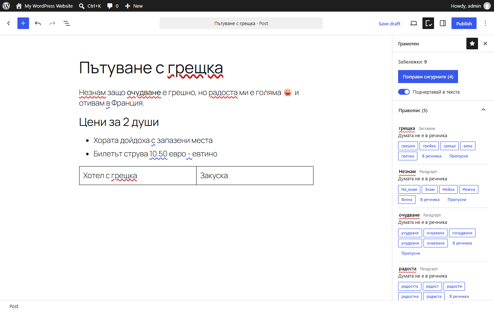
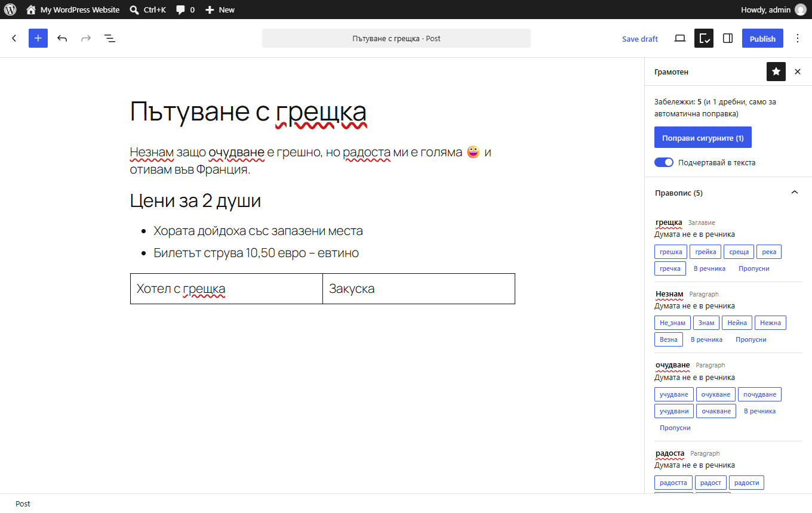
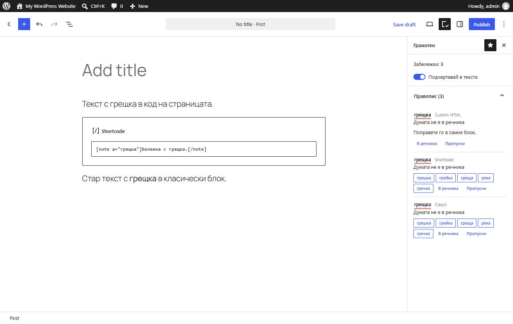

# Грамотен for WordPress

A block editor plugin: a sidebar with findings, and underlines in the text. The checker is a
TypeScript port of the Python package in `src/gramoten`, and runs in the writer's browser. No
server or external service is involved, and the text never leaves the browser.



"Поправи сигурните" applies every certain fix at once, keeps the formatting, and one undo takes it back. Spelling stays with the writer:



The text in Custom HTML, Classic and Shortcode blocks is checked too, but never their tags or attributes. In WordPress 7.1 Custom HTML is corrected in the block itself:



## What it covers

| Text | Checked | Underlined | Fixed from the sidebar |
|---|---|---|---|
| Paragraphs, headings, lists, quotes, columns, captions, buttons, verse, pullquotes, preformatted | yes | yes | yes |
| Title, table cells, Details summary | yes | yes, with the CSS Custom Highlight API; sidebar only without it | yes |
| Shortcode and Classic blocks | the text, not tags, attributes or parameters | no | yes |
| Custom HTML | the text, not tags or attributes | no | WordPress 6.6: yes. WordPress 7.1: no, see below |
| Code blocks, `<code>`, `<pre>`, scripts and styles inside markup | no | | |
| Text without Cyrillic | no | | |

## Known limits

- **The block editor only.** The Classic Editor and page builders are not supported.
- **Annotations are an experimental WordPress API.** If they go away, the sidebar keeps working and most underlines stop.
- **"Поправи сигурните" can need a second press.** Python's `fix_text` repeats until nothing changes; the button makes one pass, and a fix can make a new minor one appear (a non-breaking space in `10,50 евро`).
- **Upload limits.** The zip is about 9.3 MB, and some hosts accept less. `plugin/readme.txt` lists installs without an upload.
- **The sidebar is in Bulgarian only**, with no translation files.
- **Tested** in Chrome, Firefox and WebKit on Windows, on WordPress 7.1 and 6.6. Real Safari runs only in CI, on macOS.

## Layout

| Path | What |
|---|---|
| `src/engine/` | The port, one file per Python module. `py.ts` gives the rules Python's regular expressions |
| `src/worker.ts`, `src/load.ts` | The checker in a Web Worker, and the word lists over HTTP |
| `src/editor/` | The sidebar and the underlines |
| `plugin/` | The plugin as installed. `plugin/build/` and `plugin/data/` are generated |
| `assets/` | Screenshots, named as the WordPress.org directory expects. They go in its SVN `assets/` folder, not in the zip |
| `tests/` | The comparison with the Python package, and `markup.test.ts` |
| `tests/e2e/` | The plugin in real WordPress and real browsers |
| `tools/` | `build_data.py` (word lists), `build.mjs` (bundles), `package.py` (zip) |

## Build

From the repository root, with Node 22.18 or later and the Python environment (`uv sync`):

```sh
uv run python wordpress/tools/build_data.py
cd wordpress
npm ci
npm run build
uv run python tools/package.py   # gramoten.zip; fails over the 10 MB limit
```

## Changing a rule

The Python package is the source of the rules. Change it there, then the same rule in
`src/engine/`, where the patterns keep their Python text so the two read alike.
`tests/difftest.test.ts` fails on any difference:

```sh
uv run python wordpress/tests/make_corpus.py   # what Python says now
cd wordpress && npm test
```

For a longer hunt, `CORPUS_MUTATIONS=30` adds more mutated texts, and
`CORPUS_PROSE=tools/dl/eval/web_holdout.txt` adds real text if it is on your machine.

Word list changes need only `build_data.py`.

## Testing in a browser

`tests/e2e/run.mjs` drives a site that WordPress Playground serves:

```sh
cd wordpress/tests/e2e
npm ci
npx playwright-core install firefox webkit
npx @wp-playground/cli server --port=9400 --login --blueprint=blueprint-empty.json &
node run.mjs http://127.0.0.1:9400 --channel chrome --upload ../../gramoten.zip --remove-at-end
```

`--engine firefox` or `--engine webkit` picks another browser. For WordPress 6.6, start a new
server with `--blueprint=blueprint-66.json --mount-dir <unpacked plugin> /wordpress/wp-content/plugins/gramoten`
and leave out `--upload`. In Git Bash on Windows, set `MSYS_NO_PATHCONV=1` first.

`safari.mjs` runs the core in real Safari, which needs a Mac: `sudo safaridriver --enable`, then
`node safari.mjs <site>`. CI does this on macOS.

Use a new site for each `--upload` run. Playground can report a deleted plugin's folder as still
there, for any plugin, and the next upload then stops at "The destination directory already exists".

## How it differs from the Python package

- **Offsets** are UTF-16 units, as in the block editor; Python's are code points. The corpus converts them.
- **No `word_starts.marisa`.** It does not fit the 10 MB limit. A prefix search gives the same answers.
- **`bg_frequency` and `misspellings`** keep their value in the key, as the WASM trie reads keys only as text.
- **Custom HTML in WordPress 7.1 is read-only.** The editor hides its text from the block's attributes, and writing to it breaks undo, without this plugin too. `readOnly` in `fields.ts` keeps it to findings.
- **Not ported:** `fonts.py`, which reads HTML emails; `words.py`, as the dictionary is user meta here; `server.py`.

## Licence

The plugin as a whole is GPL-3.0-or-later, as WordPress.org requires GPL-compatible code and data.
It takes the bgOffice dictionary under GPL-2.0-or-later, one of the three licences the dictionary
offers (`plugin/NOTICE`). The Python package keeps its own licences.
